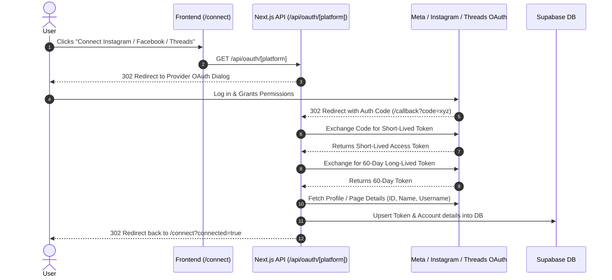

# Meta Multi-Platform OAuth Setup Guide (Instagram, Facebook & Threads)

Ye document aapko **Instagram**, **Facebook**, aur **Threads** ka direct OAuth connection setup apne kisi bhi Next.js (App Router) ya Node.js application me implement karne ke liye step-by-step complete guide provide karta hai.

---

## 📑 Index
1. [Architecture & Workflow](#1-architecture--workflow)
2. [Meta Developer Portal Configuration](#2-meta-developer-portal-configuration)
3. [Environment Configuration (`.env.local`)](#3-environment-configuration-envlocal)
4. [Database Schema (Supabase / PostgreSQL)](#4-database-schema)
5. [Complete Backend Implementation](#5-complete-backend-implementation)
   - `lib/oauthUrl.ts` (URL & Credential Helpers)
   - `app/api/oauth/[platform]/route.ts` (OAuth Initiation)
   - `app/api/oauth/[platform]/callback/route.ts` (Token Exchange & Store)
   - `lib/oauthTokens.ts` (Auto Token Refresh)
6. [Frontend UI Implementation (`app/connect/page.tsx`)](#6-frontend-ui-implementation)
7. [Important Meta Gotchas & Troubleshooting](#7-important-meta-gotchas--troubleshooting)

---

## 1. Architecture & Workflow

Is setup me **Single Meta Developer App** se teeno platforms connect hote hain. Server-side token exchange hota hai taaki client secret kabhi browser me expose na ho.



---

## 2. Meta Developer Portal Configuration

Ek single Meta Business App se Facebook, Instagram aur Threads teeno connect hote hain.

### Step 2.1: App Create Karein
1. [Meta for Developers](https://developers.facebook.com/) par login karein.
2. Click **My Apps** -> **Create App**.
3. Use Case: Choose **Other** -> App Type: **Business** (Do not choose Consumer).
4. App Display Name enter karein aur Create par click karein.

### Step 2.2: Products Add Karein
Dashboard ke left sidebar me **Add Product** par jayein aur in 3 products ko setup karein:
1. **Facebook Login for Business** (Facebook Pages ke liye)
2. **Instagram Graph API** / **Instagram Login for Business** (Direct Instagram connect ke liye)
3. **Threads API** (Threads profile connect ke liye)

### Step 2.3: OAuth Redirect URIs Whitelist Karein
**Facebook Login for Business > Settings** me jaake **Valid OAuth Redirect URIs** me add karein:
- `https://your-production-domain.com/api/oauth/facebook/callback`
- `https://your-production-domain.com/api/oauth/instagram/callback`
- `https://your-production-domain.com/api/oauth/threads/callback`
- *(Local development ke liye)*: `http://localhost:3000/api/oauth/facebook/callback` etc.

> **Important**: Instagram aur Threads direct OAuth strictly HTTPS domain require karte hain (localhost par test karne ke liye ngrok ya Vercel preview domain best hai).

### Step 2.4: Permissions & Scopes Reference Table

| Platform | Scopes Required | Purpose |
| :--- | :--- | :--- |
| **Facebook** | `public_profile`, `pages_show_list`, `pages_read_engagement`, `pages_manage_posts`, `pages_messaging`, `pages_read_user_content` | Page list read karna, Page Access Token lena, post publish karna |
| **Instagram** | `instagram_business_basic`, `instagram_business_manage_messages`, `instagram_business_manage_comments`, `instagram_business_content_publish` | Instagram Professional / Creator account media read, post publish & auto-reply |
| **Threads** | `threads_basic`, `threads_content_publish` | Threads profile read, text & media thread create karna |

---

## 3. Environment Configuration (`.env.local`)

Apne project ke `.env.local` me ye keys configure karein:

```env
# Application Base URL (No trailing slash)
NEXT_PUBLIC_APP_URL=https://your-domain.com

# Meta App (Facebook & Threads)
META_CLIENT_ID=your_meta_app_id
META_CLIENT_SECRET=your_meta_app_secret

# Instagram Direct Credentials (Same Meta App ID ya Instagram App ID)
INSTAGRAM_CLIENT_ID=your_instagram_app_id
INSTAGRAM_CLIENT_SECRET=your_instagram_app_secret

# Database (Supabase)
NEXT_PUBLIC_SUPABASE_URL=https://your-project.supabase.co
NEXT_PUBLIC_SUPABASE_ANON_KEY=your_anon_key
SUPABASE_SERVICE_ROLE_KEY=your_server_service_role_key
```

---

## 4. Database Schema

Database me tokens aur connected accounts store karne ke liye Supabase SQL Editor me ye script run karein:

```sql
CREATE EXTENSION IF NOT EXISTS "pgcrypto";

CREATE TABLE IF NOT EXISTS public.accounts (
  id UUID PRIMARY KEY DEFAULT gen_random_uuid(),
  client_name TEXT NOT NULL,
  platform TEXT NOT NULL CHECK (platform IN ('Instagram', 'Facebook', 'Threads', 'YouTube')),
  connection_type TEXT NOT NULL DEFAULT 'oauth' CHECK (connection_type IN ('manual', 'mock', 'oauth')),
  connection_status TEXT NOT NULL DEFAULT 'Connected' CHECK (connection_status IN ('Connected', 'Disconnected', 'Pending')),
  oauth_access_token TEXT,
  oauth_refresh_token TEXT,
  oauth_account_id TEXT UNIQUE,
  oauth_token_expires_at TIMESTAMPTZ,
  created_at TIMESTAMPTZ NOT NULL DEFAULT NOW(),
  updated_at TIMESTAMPTZ NOT NULL DEFAULT NOW()
);

-- Index for quick token lookup
CREATE INDEX IF NOT EXISTS idx_accounts_platform ON public.accounts(platform);
CREATE INDEX IF NOT EXISTS idx_accounts_oauth_id ON public.accounts(oauth_account_id);
```

---

## 5. Complete Backend Implementation

### File 1: `lib/oauthUrl.ts`
Ye helper dynamic request origin aur clean credentials resolve karti hai:

```typescript
import type { NextRequest } from 'next/server';

export function getAppBaseUrl(request?: NextRequest): string {
  if (request) {
    const origin = request.nextUrl.origin.replace(/\/+$/, '');
    if (origin && !origin.includes('undefined')) return origin;
  }
  return (process.env.NEXT_PUBLIC_APP_URL || 'http://localhost:3000').replace(/\/+$/, '');
}

export function getOAuthRedirectUri(platform: string, request?: NextRequest): string {
  const base = getAppBaseUrl(request);
  return `${base}/api/oauth/${platform.toLowerCase()}/callback`;
}

export function getCleanMetaCredentials(): { clientId: string; clientSecret: string } {
  return {
    clientId: (process.env.META_CLIENT_ID || '').trim().replace(/^["']|["']$/g, ''),
    clientSecret: (process.env.META_CLIENT_SECRET || '').trim().replace(/^["']|["']$/g, ''),
  };
}

export function getCleanInstagramCredentials(): { clientId: string; clientSecret: string } {
  return {
    clientId: (process.env.INSTAGRAM_CLIENT_ID || process.env.META_CLIENT_ID || '').trim().replace(/^["']|["']$/g, ''),
    clientSecret: (process.env.INSTAGRAM_CLIENT_SECRET || process.env.META_CLIENT_SECRET || '').trim().replace(/^["']|["']$/g, ''),
  };
}
```

---

### File 2: `app/api/oauth/[platform]/route.ts`
OAuth Initiation route jo server-side validate karke provider dialog par redirect karta hai:

```typescript
import { NextRequest, NextResponse } from 'next/server';
import {
  getOAuthRedirectUri,
  getCleanMetaCredentials,
  getCleanInstagramCredentials,
} from '@/lib/oauthUrl';

export async function GET(
  request: NextRequest,
  context: { params: Promise<{ platform: string }> }
) {
  const { platform } = await context.params;
  const platformKey = platform.toLowerCase();

  const searchParams = request.nextUrl.searchParams;
  const stateData = JSON.stringify({
    userId: searchParams.get('userId') || null,
    accountId: searchParams.get('accountId') || null,
  });
  const stateQuery = `&state=${encodeURIComponent(Buffer.from(stateData).toString('base64'))}`;
  const redirectUri = getOAuthRedirectUri(platformKey, request);

  // 1. FACEBOOK OAUTH
  if (platformKey === 'facebook') {
    const { clientId } = getCleanMetaCredentials();
    const scopes = 'public_profile,pages_show_list,pages_read_engagement,pages_manage_posts,pages_messaging,pages_read_user_content';
    const authUrl = `https://www.facebook.com/v22.0/dialog/oauth?client_id=${clientId}&redirect_uri=${encodeURIComponent(
      redirectUri
    )}&scope=${encodeURIComponent(scopes)}&response_type=code${stateQuery}`;

    return NextResponse.redirect(authUrl);
  }

  // 2. INSTAGRAM DIRECT OAUTH (Instagram Professional Login)
  if (platformKey === 'instagram') {
    const { clientId } = getCleanInstagramCredentials();
    const scopes = 'instagram_business_basic,instagram_business_manage_messages,instagram_business_manage_comments,instagram_business_content_publish';
    const authUrl = `https://www.instagram.com/oauth/authorize?enable_fb_login=0&force_authentication=1&client_id=${clientId}&redirect_uri=${encodeURIComponent(
      redirectUri
    )}&scope=${encodeURIComponent(scopes)}&response_type=code${stateQuery}`;

    return NextResponse.redirect(authUrl);
  }

  // 3. THREADS OAUTH
  if (platformKey === 'threads') {
    const { clientId } = getCleanMetaCredentials();
    const scopes = 'threads_basic,threads_content_publish';
    const authUrl = `https://threads.net/oauth/authorize?client_id=${clientId}&app_id=${clientId}&redirect_uri=${encodeURIComponent(
      redirectUri
    )}&scope=${encodeURIComponent(scopes)}&response_type=code${stateQuery}`;

    return NextResponse.redirect(authUrl);
  }

  return NextResponse.redirect(new URL('/connect?error=unsupported_platform', request.url));
}
```

---

### File 3: `app/api/oauth/[platform]/callback/route.ts`
OAuth callback route jo short-lived code ko 60-day token me exchange karke Supabase me save karta hai:

```typescript
import { NextRequest, NextResponse } from 'next/server';
import { createClient } from '@supabase/supabase-js';
import {
  getOAuthRedirectUri,
  getCleanMetaCredentials,
  getCleanInstagramCredentials,
} from '@/lib/oauthUrl';

const supabase = createClient(
  process.env.NEXT_PUBLIC_SUPABASE_URL!,
  process.env.SUPABASE_SERVICE_ROLE_KEY!
);

export async function GET(
  request: NextRequest,
  context: { params: Promise<{ platform: string }> }
) {
  const { platform } = await context.params;
  const platformKey = platform.toLowerCase();

  const searchParams = request.nextUrl.searchParams;
  const code = searchParams.get('code');
  const error = searchParams.get('error');

  if (error || !code) {
    return NextResponse.redirect(
      new URL(`/connect?error=oauth_denied&platform=${platformKey}`, request.url)
    );
  }

  const redirectUri = getOAuthRedirectUri(platformKey, request);

  try {
    let accessToken = '';
    let accountId = '';
    let clientName = '';
    let expiresAt: string | null = null;

    // ========================================================
    // 1. INSTAGRAM CALLBACK (Direct Instagram Login)
    // ========================================================
    if (platformKey === 'instagram') {
      const { clientId, clientSecret } = getCleanInstagramCredentials();

      // Step A: Exchange code for short-lived token
      const igTokenRes = await fetch('https://api.instagram.com/oauth/access_token', {
        method: 'POST',
        headers: { 'Content-Type': 'application/x-www-form-urlencoded' },
        body: new URLSearchParams({
          client_id: clientId,
          client_secret: clientSecret,
          grant_type: 'authorization_code',
          redirect_uri: redirectUri,
          code,
        }),
      });
      const igTokenData = await igTokenRes.json();
      if (!igTokenRes.ok || !igTokenData.access_token) {
        throw new Error(igTokenData.error_message || 'Instagram code exchange failed');
      }

      let igToken = igTokenData.access_token;
      accountId = String(igTokenData.user_id || `ig-${Date.now()}`);

      // Step B: Exchange for 60-day Long-Lived Token
      try {
        const longRes = await fetch(
          `https://graph.instagram.com/access_token?grant_type=ig_exchange_token&client_secret=${clientSecret}&access_token=${igToken}`
        );
        const longData = await longRes.json();
        if (longData.access_token) {
          igToken = longData.access_token;
          expiresAt = new Date(Date.now() + (longData.expires_in || 5184000) * 1000).toISOString();
        }
      } catch (err) {
        console.warn('IG long-lived exchange warning:', err);
      }
      accessToken = igToken;

      // Step C: Fetch Profile Info
      try {
        const meRes = await fetch(
          `https://graph.instagram.com/v22.0/me?fields=id,username,name&access_token=${accessToken}`
        );
        const meData = await meRes.json();
        clientName = meData.username || meData.name || 'Instagram User';
        if (meData.id) accountId = meData.id;
      } catch {
        clientName = 'Instagram Account';
      }
    }

    // ========================================================
    // 2. FACEBOOK CALLBACK (Page Access Token)
    // ========================================================
    else if (platformKey === 'facebook') {
      const { clientId, clientSecret } = getCleanMetaCredentials();

      // Step A: Exchange code for user access token
      const tokenRes = await fetch(
        `https://graph.facebook.com/v22.0/oauth/access_token?client_id=${clientId}&redirect_uri=${encodeURIComponent(
          redirectUri
        )}&client_secret=${clientSecret}&code=${code}`
      );
      const tokenData = await tokenRes.json();
      if (!tokenRes.ok || !tokenData.access_token) {
        throw new Error(tokenData.error?.message || 'Facebook token exchange failed');
      }

      let userToken = tokenData.access_token;

      // Step B: Exchange for 60-day Long-Lived Token
      try {
        const longRes = await fetch(
          `https://graph.facebook.com/v22.0/oauth/access_token?grant_type=fb_exchange_token&client_id=${clientId}&client_secret=${clientSecret}&fb_exchange_token=${userToken}`
        );
        const longData = await longRes.json();
        if (longData.access_token) {
          userToken = longData.access_token;
          expiresAt = new Date(Date.now() + (longData.expires_in || 5184000) * 1000).toISOString();
        }
      } catch (e) {
        console.warn('Facebook long-lived exchange warning:', e);
      }

      // Step C: Fetch Managed Pages & Permanent Page Access Token
      const accountsRes = await fetch(
        `https://graph.facebook.com/v22.0/me/accounts?fields=id,name,access_token,tasks&access_token=${userToken}`
      );
      const accountsData = await accountsRes.json();

      if (accountsData.data && Array.isArray(accountsData.data) && accountsData.data.length > 0) {
        const targetPage = accountsData.data.find(
          (p: any) => p.tasks?.includes('CREATE_CONTENT') || p.tasks?.includes('MANAGE')
        ) || accountsData.data[0];

        accountId = targetPage.id;
        clientName = targetPage.name;
        // Page access tokens derived from long-lived user tokens do not expire!
        accessToken = targetPage.access_token;
      } else {
        const meRes = await fetch(`https://graph.facebook.com/v22.0/me?access_token=${userToken}`);
        const meData = await meRes.json();
        accountId = meData.id || `fb-${Date.now()}`;
        clientName = meData.name || 'Facebook User';
        accessToken = userToken;
      }
    }

    // ========================================================
    // 3. THREADS CALLBACK (Threads Profile)
    // ========================================================
    else if (platformKey === 'threads') {
      const { clientId, clientSecret } = getCleanMetaCredentials();

      // Step A: Exchange code for short-lived Threads token
      const tokenRes = await fetch('https://graph.threads.net/oauth/access_token', {
        method: 'POST',
        headers: { 'Content-Type': 'application/x-www-form-urlencoded' },
        body: new URLSearchParams({
          client_id: clientId,
          client_secret: clientSecret,
          grant_type: 'authorization_code',
          redirect_uri: redirectUri,
          code,
        }),
      });
      const tokenData = await tokenRes.json();
      if (!tokenRes.ok || !tokenData.access_token) {
        throw new Error(tokenData.error_message || 'Threads code exchange failed');
      }

      let thToken = tokenData.access_token;
      accountId = String(tokenData.user_id || `threads-${Date.now()}`);

      // Step B: Exchange for 60-day Long-Lived Token
      try {
        const longRes = await fetch(
          `https://graph.threads.net/access_token?grant_type=th_exchange_token&client_secret=${clientSecret}&access_token=${thToken}`
        );
        const longData = await longRes.json();
        if (longData.access_token) {
          thToken = longData.access_token;
          expiresAt = new Date(Date.now() + (longData.expires_in || 5184000) * 1000).toISOString();
        }
      } catch (e) {
        console.warn('Threads long-lived exchange warning:', e);
      }
      accessToken = thToken;

      // Step C: Fetch Profile username
      try {
        const meRes = await fetch(`https://graph.threads.net/v1.0/me?fields=id,username&access_token=${accessToken}`);
        const meData = await meRes.json();
        if (meData.username) {
          clientName = meData.username;
          accountId = meData.id || accountId;
        } else {
          clientName = 'Threads User';
        }
      } catch {
        clientName = 'Threads Account';
      }
    }

    const formattedPlatform =
      platformKey === 'instagram' ? 'Instagram' : platformKey === 'facebook' ? 'Facebook' : 'Threads';

    // ========================================================
    // 4. Save to Database (Supabase Upsert)
    // ========================================================
    const { error: dbError } = await supabase.from('accounts').upsert(
      {
        client_name: clientName,
        platform: formattedPlatform,
        connection_type: 'oauth',
        connection_status: 'Connected',
        oauth_access_token: accessToken,
        oauth_account_id: accountId,
        oauth_token_expires_at: expiresAt,
        updated_at: new Date().toISOString(),
      },
      { onConflict: 'oauth_account_id' }
    );

    if (dbError) {
      console.error('[DB Upsert Error]:', dbError);
    }

    return NextResponse.redirect(
      new URL(`/connect?connected=true&platform=${platformKey}&name=${encodeURIComponent(clientName)}`, request.url)
    );
  } catch (err: any) {
    console.error('OAuth Callback Error:', err);
    return NextResponse.redirect(
      new URL(`/connect?error=${encodeURIComponent(err.message || 'OAuth exchange failed')}&platform=${platformKey}`, request.url)
    );
  }
}
```

---

### File 4: `lib/oauthTokens.ts`
Auto Token Refresh Manager jo publish karne ya comment reply karne se pehle check karta hai ki token valid hai ya expire hone wala hai:

```typescript
import { createClient } from '@supabase/supabase-js';
import { getCleanMetaCredentials } from './oauthUrl';

const supabase = createClient(
  process.env.NEXT_PUBLIC_SUPABASE_URL!,
  process.env.SUPABASE_SERVICE_ROLE_KEY!
);

export async function getValidAccessToken(accountId: string): Promise<{
  accessToken: string;
  platform: string;
  oauthAccountId?: string;
  clientName: string;
}> {
  const { data: account, error } = await supabase
    .from('accounts')
    .select('*')
    .eq('id', accountId)
    .single();

  if (error || !account) {
    throw new Error(`Account not found for ID: ${accountId}`);
  }

  const now = Date.now();
  const expiresAt = account.oauth_token_expires_at ? new Date(account.oauth_token_expires_at).getTime() : null;
  // If expiring in next 24 hours, refresh it
  const isExpiringSoon = expiresAt ? (expiresAt - now) < 24 * 60 * 60 * 1000 : false;

  if (!isExpiringSoon && account.oauth_access_token) {
    return {
      accessToken: account.oauth_access_token,
      platform: account.platform,
      oauthAccountId: account.oauth_account_id,
      clientName: account.client_name,
    };
  }

  const { clientId, clientSecret } = getCleanMetaCredentials();
  let refreshedToken = account.oauth_access_token;
  let newExpiresAt: string | null = null;

  try {
    if (account.platform === 'Instagram') {
      const res = await fetch(
        `https://graph.instagram.com/refresh_access_token?grant_type=ig_refresh_token&access_token=${account.oauth_access_token}`
      );
      const data = await res.json();
      if (res.ok && data.access_token) {
        refreshedToken = data.access_token;
        newExpiresAt = new Date(Date.now() + (data.expires_in || 5184000) * 1000).toISOString();
      }
    } else if (account.platform === 'Threads') {
      const res = await fetch(
        `https://graph.threads.net/access_token?grant_type=th_exchange_token&client_secret=${clientSecret}&access_token=${account.oauth_access_token}`
      );
      const data = await res.json();
      if (res.ok && data.access_token) {
        refreshedToken = data.access_token;
        newExpiresAt = new Date(Date.now() + (data.expires_in || 5184000) * 1000).toISOString();
      }
    } else if (account.platform === 'Facebook') {
      const res = await fetch(
        `https://graph.facebook.com/v22.0/oauth/access_token?grant_type=fb_exchange_token&client_id=${clientId}&client_secret=${clientSecret}&fb_exchange_token=${account.oauth_access_token}`
      );
      const data = await res.json();
      if (res.ok && data.access_token) {
        refreshedToken = data.access_token;
        newExpiresAt = new Date(Date.now() + (data.expires_in || 5184000) * 1000).toISOString();
      }
    }

    if (refreshedToken !== account.oauth_access_token) {
      await supabase
        .from('accounts')
        .update({
          oauth_access_token: refreshedToken,
          ...(newExpiresAt ? { oauth_token_expires_at: newExpiresAt } : {}),
          updated_at: new Date().toISOString(),
        })
        .eq('id', account.id);
    }
  } catch (refreshErr) {
    console.warn(`[OAuth Refresh Warning]:`, refreshErr);
  }

  return {
    accessToken: refreshedToken,
    platform: account.platform,
    oauthAccountId: account.oauth_account_id,
    clientName: account.client_name,
  };
}
```

---

## 6. Frontend UI Implementation

### `app/connect/page.tsx`
Minimal frontend buttons to initiate individual channel connect:

```tsx
'use client';

import React from 'react';
import { useSearchParams } from 'next/navigation';

export default function ConnectPage() {
  const searchParams = useSearchParams();
  const connected = searchParams.get('connected');
  const platform = searchParams.get('platform');
  const name = searchParams.get('name');
  const error = searchParams.get('error');

  return (
    <div style={{ maxWidth: '600px', margin: '40px auto', fontFamily: 'sans-serif', padding: '20px' }}>
      <h1>Connect Social Channels</h1>
      <p>Connect your Instagram, Facebook Pages, or Threads profile via OAuth:</p>

      {connected && (
        <div style={{ padding: '12px', background: '#d1fae5', color: '#065f46', borderRadius: '8px', marginBottom: '16px' }}>
          ✅ {platform} connected successfully: <strong>{name}</strong>
        </div>
      )}

      {error && (
        <div style={{ padding: '12px', background: '#fee2e2', color: '#991b1b', borderRadius: '8px', marginBottom: '16px' }}>
          ❌ Connection Error: {error}
        </div>
      )}

      <div style={{ display: 'flex', flexDirection: 'column', gap: '14px', marginTop: '20px' }}>
        {/* Instagram */}
        <a
          href="/api/oauth/instagram"
          style={{
            padding: '12px 20px',
            background: 'linear-gradient(45deg, #f09433, #dc2743, #bc1888)',
            color: '#fff',
            textDecoration: 'none',
            borderRadius: '8px',
            fontWeight: 600,
            textAlign: 'center',
          }}
        >
          Connect Instagram (Direct Login)
        </a>

        {/* Facebook */}
        <a
          href="/api/oauth/facebook"
          style={{
            padding: '12px 20px',
            background: '#1877f2',
            color: '#fff',
            textDecoration: 'none',
            borderRadius: '8px',
            fontWeight: 600,
            textAlign: 'center',
          }}
        >
          Connect Facebook Pages
        </a>

        {/* Threads */}
        <a
          href="/api/oauth/threads"
          style={{
            padding: '12px 20px',
            background: '#000000',
            color: '#fff',
            textDecoration: 'none',
            borderRadius: '8px',
            fontWeight: 600,
            textAlign: 'center',
          }}
        >
          Connect Threads Profile
        </a>
      </div>
    </div>
  );
}
```

---

## 7. Important Meta Gotchas & Troubleshooting

1. **Instagram Account Type Requirement:**
   - Direct Instagram Login / Instagram Graph API strictly **Personal accounts support nahi karta**.
   - Account **Creator** ya **Business / Professional** hona mandatory hai (Instagram mobile app me *Settings > Account type and tools > Switch to professional account*).

2. **Facebook Page vs User Posting:**
   - Facebook par post publish karne ke liye **Page Access Token** ki zaroorat hoti hai (`/me/accounts` endpoint se milta hai). User profile posting Meta ne disable kar rakhi hai.
   - Jo user login kar raha hai, uske pass Page par **Task: CREATE_CONTENT** ya **ADMIN/MANAGE** role hona chahiye.

3. **Redirect URI Mismatch Error:**
   - Meta exact match require karta hai: `https://your-domain.com/api/oauth/instagram/callback`
   - Agar slash `/` ka fark ho ya `http` vs `https` ka difference ho, to Meta `OAuth error: redirect_uri mismatch` throw karega.

4. **App Mode: Development vs Live:**
   - Jab tak aapka Meta App **Development Mode** me hai, tab tak sirf wahi accounts login kar sakte hain jo Meta App dashboard ke *App Roles / Roles* section me as **Developer**, **Tester**, ya **Admin** added hain.
   - Public users ke login ke liye aapko Meta **App Review** submit karna padta hai permissions ke liye aur app ko **Live** mode par switch karna hota hai.
